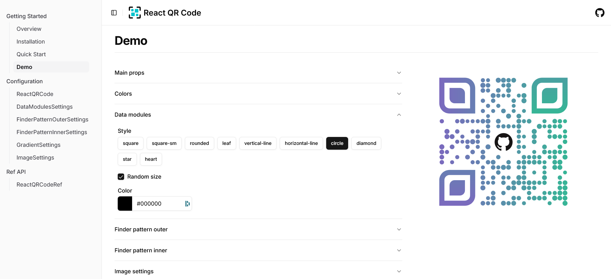

# @lglab/react-qr-code

A highly customizable and lightweight QR code generator for React applications.

🚀 **Live Demo:** [reactqrcode.com/demo](https://reactqrcode.com/demo)  
📖 **Documentation:** [reactqrcode.com](https://reactqrcode.com/)

## Quick Features

- **Highly Customizable** - Style the finder patterns, modules, and colors exactly how you want.
- **Frames** - Wrap the QR code in a frame with a call-to-action label like "Scan me!".
- **Performance Optimized** - Generates QR codes efficiently without sacrificing quality.
- **SVG-Based Rendering** - Crisp and scalable output for web and print
- **React Native** - The same component renders in React Native and Expo through react-native-svg.
- **Developer-Friendly** - Built with TypeScript, easy to use, and well-documented.

## Install

```
pnpm add @lglab/react-qr-code
```

or

```
npm i @lglab/react-qr-code
```

or

```
yarn add @lglab/react-qr-code
```

or

```
bun add @lglab/react-qr-code
```

## Quick Start

```
import { ReactQRCode } from '@lglab/react-qr-code'

const Page = () => {
  return (
    <ReactQRCode value='https://reactqrcode.com' />
  );
}
```

## React Native

The same component works in React Native 0.82+ and Expo SDK 55+. Install it with react-native-svg:

```
npx expo install @lglab/react-qr-code react-native-svg
```

Import it as above; Metro picks the native build automatically. The native ref has `toDataURL()` (a PNG data URL) instead of `download()`. See [reactqrcode.com/react-native](https://reactqrcode.com/react-native) for the details.
